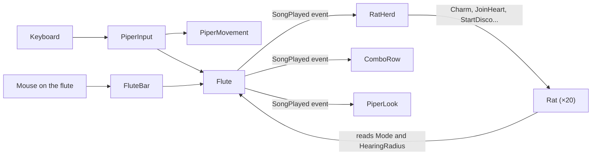

# The Piper: the toy

A toy, not a game: there is no goal, no timer and no score. You walk the Piper around a plain field and play
his six-hole flute, and the rats react to the music. Holding a note calls, marches or scares them, and a few
notes in a row play a song that makes them dance, form a heart, float away and more.

## Play it

Open `Scenes/Toy` and press Play.

| Key | What it does |
|---|---|
| WASD or the arrows | Walk |
| Hold 1 or 2 | Call: nearby rats turn gold and follow you |
| Hold 3 or 4 | March: nearby rats walk ahead of you |
| Hold 5 or 6 | Scare: nearby rats run away |
| A combo from the bar along the bottom | Play a song |

You can also press the holes of the flute at the bottom of the screen with the mouse. The gold ring shows how
far the music reaches while you hold a note.

| Song | Keys | What the rats do |
|---|---|---|
| Dance | 1 3 5 | Everyone nearby is charmed and follows you |
| Conga | 2 1 1 2 | They walk in a line behind you |
| Heart | 4 1 4 | They stand in a heart around you |
| Disco | 6 1 6 | They spin round in flashing colors |
| Balloons | 2 4 6 | They swell up, float away on the wind and pop |
| Choir | 1 2 3 4 | They follow you, hopping and singing |
| Crowd Surf | 3 3 6 | They follow you and lift you up |
| Faint | 6 4 2 | They roll over and play dead |

A song rests for about ten seconds after you play it, and its chip fades until it is ready again.

## The Hierarchy

Everything in the scene is a GameObject with components. Click one to see its components in the Inspector.

```text
Toy
├── Main Camera     Camera, Audio Listener, CameraFollow
├── Ground          Sprite Renderer, Edge Collider 2D (the invisible edge of the field)
├── Piper           Rigidbody 2D, Circle Collider 2D, 2 Audio Sources,
│   │               PiperMovement, Flute, PiperInput, PiperLook
│   ├── Body        Sprite Renderer (the Piper's picture, which turns and lifts)
│   └── Music Ring  Sprite Renderer (shown while a note is held)
├── Rats            RatHerd (creates the rats when the game starts)
│   └── Rat 1..20   copies of the Rat prefab, made in Play Mode
└── HUD             UI Document, ComboRow, FluteBar
```

The **Rat prefab** (`Prefabs/Rat`) is one rat, saved so it can be copied many times:

```text
Rat             Rigidbody 2D, Circle Collider 2D, Animator, Rat
├── Body        turns to face where the rat walks, swells or flips with its mood
│   └── Sprite  Sprite Renderer (the Animator makes it waddle)
└── Song Notes  Particle System (notes that float up while it sings)
```

## The project folders

| Folder | What is in it |
|---|---|
| `Scenes` | `Toy`, the only scene |
| `Scripts` | The C# code, one class per file, in folders by topic |
| `Prefabs` | `Rat` |
| `Songs` | One asset per song. Select one to change its keys, reach, length, rest or color |
| `Art` | The sprites, and the material of the floating notes |
| `Animation` | The rat's Animator Controller and its Idle and Walk clips |
| `Audio` | The six flute notes, one tune per song, and the balloon pop |
| `UI` | The HUD's layout (`ToyHud.uxml`), its style (`ToyHud.uss`) and one combo chip (`ComboChip.uxml`) |
| `Tests` | EditMode and PlayMode tests |

## The scripts

Each script does one job. The Unity ideas they use are explained in `docs/FUNDAMENTALS.md`.

| Script | On | What it does | Unity ideas it shows |
|---|---|---|---|
| `PiperInput` | Piper | Reads the keyboard and passes it on to `PiperMovement` and `Flute` | `Update`, `Input.GetKey`, `GetComponent` in `Awake` |
| `PiperMovement` | Piper | Walks the Piper with physics | `Rigidbody2D`, `FixedUpdate` |
| `PiperLook` | Piper | Turns the Body the way the Piper walks, and lifts it in Crowd Surf | Moving a child object, listening to an event |
| `Flute` | Piper | Plays the held note, decides call, march or scare, and spots songs | `AudioSource`, C# events, `OnValidate` |
| `ComboReader` | (none) | Remembers the last notes and finds the song they spell | A plain C# class, created with `new` |
| `Song` | (asset) | One song's keys, reach, length, rest, color and tune | `ScriptableObject`, `CreateAssetMenu` |
| `RatHerd` | Rats | Creates the rats, then gives each song's part to the rats that hear it | Prefabs and `Instantiate`, events |
| `Rat` | Rat prefab | Moves one rat by its mood, and shows the mood | `Rigidbody2D`, `Animator`, `ParticleSystem` |
| `CameraFollow` | Main Camera | Follows the Piper smoothly | `LateUpdate`, `SmoothDamp` |
| `ComboRow` | HUD | Shows every song with its keys, glowing and resting | UI Toolkit, UXML templates, USS classes |
| `FluteBar` | HUD | Lights the held holes and lets the mouse play them | UI Toolkit pointer events |

`SongEffect`, `FluteMode` and `RatMood` are small enums: lists of named choices that the scripts switch on.

## How the pieces talk



- **Inspector references:** the scripts find each other through fields filled in the Inspector, such as the
  `Flute` slot on `RatHerd`. Nothing searches the scene by name.
- **Events:** the `Flute` does not know who listens. `RatHerd`, `ComboRow` and `PiperLook` subscribe to its
  `SongPlayed` event in `OnEnable` and unsubscribe in `OnDisable`.
- **Moods:** every rat checks the flute in `Update` and moves in `FixedUpdate`. While a song is in charge of a rat,
  the flute's held notes cannot interrupt it.

## Changing the toy

Everything below is a field in the Inspector; no code needs to change.

| To change | Select | Field |
|---|---|---|
| The Piper's speed | Piper | `PiperMovement` › Speed |
| The keys | Piper | `PiperInput` › Up, Down, Left, Right and Hole Keys |
| How far the music reaches | Piper | `Flute` › Hearing Radius (the ring follows it) |
| How many rats there are | Rats | `RatHerd` › Rat Count |
| The rats' speed, colors or charm time | `Prefabs/Rat` | `Rat` › Wander Speed, Run Speed and the rest |
| A song | Its asset in `Songs` | Keys, Radius, Seconds, Rest Seconds, Color, Sound |
| The HUD's look | `UI/ToyHud.uss` | Edit it, or open `UI/ToyHud.uxml` in UI Builder |

To add a song, use **Assets › Create › Piper Toy › Song**, fill it in and drag it into the `Flute`'s Songs list.
Its effect has to be one of the eight in `SongEffect`.

The sounds come from `Tools/toy-sounds/make_sounds.py`. Run it to make them again.

## Tests

Open **Window › General › Test Runner**.

- **EditMode:** `ComboReaderTests` check that notes spell the right song, within three seconds.
- **PlayMode:** `ToyTests` load the Toy scene. They check walking, the edge of the field, calling, marching and
  scaring, every song, resting, Crowd Surf, Balloons, the combos row and the flute bar.
