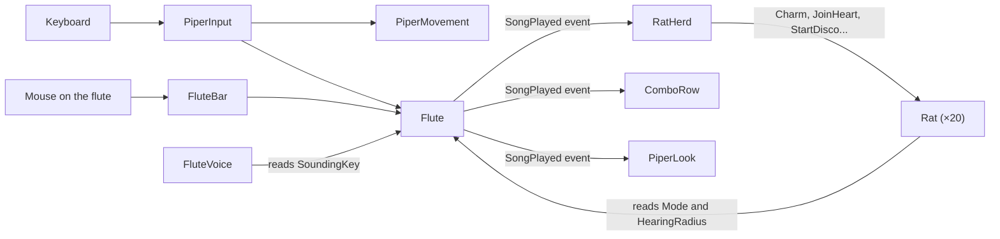

# The Piper: the toy

A toy, not a game: there is no goal, no timer and no score. You walk the Piper around an open field and play
his six-hole flute, and the rats react to the music. The pictures are the team's own: the Piper, the field,
the flute, the shapes standing on the field as obstacles, and frogs in place of the rats. The code still calls them rats, as
the old game did. Holding a note calls, marches or scares them, and a few
notes in a row play a song that makes them dance, form a heart, float away and more.

## Play it

Open `Scenes/Toy` and press Play.

| Key | What it does |
|---|---|
| WASD or the arrows | Walk |
| Hold 1 or 2 | Call: nearby rats turn gold and follow you |
| Hold 3 or 4 | March: nearby rats walk ahead of you |
| Hold 5 or 6 | Scare: nearby rats run away |
| A combo from the bar along the bottom | Play a song |
| R | Start the toy again from the beginning |

You can also press the holes of the flute on the right of the screen with the mouse; it shows the hole being
played. While you hold a note, a soft glow in that hole's colour shows how far the music reaches, with waves
rolling out to its edge, and musical notes float up from the Piper in the same colour, as in the old game. The
team's shapes stand on the field as obstacles: the Piper and the frogs bump into them.

| Song | Keys | What the rats do |
|---|---|---|
| Dance | 1 3 5 | Everyone nearby is charmed and follows you |
| Conga | 2 1 1 2 | They run to their places in a line behind you and follow your footsteps one after another; the dance's seconds start once the line is formed |
| Heart | 4 1 4 | They stand in a heart around you; its seconds start once the heart is formed |
| Disco | 6 1 6 | They spin on the spot over soft lights that change colour on the beat, in the flute's hole colours |
| Balloons | 2 4 6 | They swell up, float slowly up the screen and a little right, and pop |
| Choir | 1 2 3 4 | They follow you, hopping and singing |
| Crowd Surf | 3 3 6 | They gather under you and lift you up; once they are under you, the crowd carries you wherever you steer at twice your walking speed |
| Faint | 6 4 2 | They roll over and play dead |

A song rests for about ten seconds after you play it, and its chip fades until it is ready again.

## The Hierarchy

Everything in the scene is a GameObject with components. Click one to see its components in the Inspector.

```text
Toy
├── Game            RestartKey (R starts the toy again)
├── Main Camera     Camera, Audio Listener, CameraFollow
├── Ground          Sprite Renderer (the team's background), Edge Collider 2D (follows the field's outline)
├── Obstacles       an empty parent
│   └── Shape 1..6  Sprite Renderer, Polygon Collider 2D (the team's shapes 1, 2, 4, 5 and 6, two of each)
├── Piper           Rigidbody 2D, Circle Collider 2D, Audio Source (the song tunes),
│   │               PiperMovement, Flute, PiperInput, PiperLook
│   ├── Body        Sprite Renderer (the Piper's picture, which turns and lifts)
│   ├── Music Ring  Sprite Renderer, MusicRing (the glow that shows the music's reach while a note is held)
│   │   └── Wave 1..3 Sprite Renderer (the waves that roll out to its edge)
│   ├── Flute Voice Audio Source, FluteVoice (plays the held note)
│   └── Music Notes Particle System, MusicNotes (musical notes, while a note is held)
├── Rats            RatHerd (creates the rats when the game starts)
│   └── Rat 1..20   copies of the Rat prefab, made in Play Mode
└── HUD             UI Document, ComboRow, FluteBar
```

The **Rat prefab** (`Prefabs/Rat`) is one rat, saved so it can be copied many times:

```text
Rat             Rigidbody 2D, Circle Collider 2D, Animator, Rat
├── Disco Light Sprite Renderer (the soft light under the rat during Disco)
├── Body        turns to face where the rat walks, swells or flips with its mood, spins in Disco
│   └── Sprite  Sprite Renderer (the team's frog; the Animator makes it waddle)
└── Song Notes  Particle System (notes that float up while it sings)
```

## The project folders

| Folder | What is in it |
|---|---|
| `Scenes` | `Toy`, the only scene |
| `Scripts` | The C# code, one class per file, in folders by topic |
| `Prefabs` | `Rat` |
| `Songs` | One asset per song. Select one to change its keys, reach, length, rest or color |
| `Art` | The team's sprites (Piper, Frog, Background, Flute and FluteHole1 to 6, Shape1, 2, 4, 5 and 6), the ring and note sprites, and the material of the floating notes |
| `Animation` | The rat's Animator Controller and its Idle and Walk clips |
| `Audio` | One tune per song, and the balloon pop. The flute's notes are played live by `FluteVoice` |
| `UI` | The HUD's layout (`ToyHud.uxml`), its style (`ToyHud.uss`) and one combo chip (`ComboChip.uxml`) |
| `Tests` | EditMode and PlayMode tests |

## The scripts

Each script does one job. The Unity ideas they use are explained in `docs/FUNDAMENTALS.md`.

| Script | On | What it does | Unity ideas it shows |
|---|---|---|---|
| `PiperInput` | Piper | Reads the keyboard and passes it on to `PiperMovement` and `Flute` | `Update`, `Input.GetKey`, `GetComponent` in `Awake` |
| `PiperMovement` | Piper | Walks the Piper with physics, twice as fast while the Crowd Surf crowd carries it | `Rigidbody2D`, `FixedUpdate` |
| `PiperLook` | Piper | Eases the Body round to face the way the Piper walks, and lifts it in Crowd Surf | Moving a child object, `Quaternion.Lerp`, listening to an event |
| `Flute` | Piper | Decides call, march or scare from the held hole, and spots songs | C# events |
| `FluteVoice` | Flute Voice | Plays the held note with the old game's synthesizer | `OnAudioFilterRead`, the audio thread |
| `FluteSynth` | (none) | Makes the flute's sound sample by sample: it glides between notes and fades out | A plain C# class |
| `FluteSound` | (none) | The flute's pitches, vibrato, breath and fades, shown in the Flute Voice's Inspector | `[Serializable]` |
| `ComboReader` | (none) | Remembers the last notes and finds the song they spell | A plain C# class, created with `new` |
| `Song` | (asset) | One song's keys, reach, length, rest, color and tune | `ScriptableObject`, `CreateAssetMenu` |
| `RatHerd` | Rats | Creates the rats on free spots, then gives each song's part to the rats that hear it | Prefabs and `Instantiate`, `Physics2D.OverlapCircle`, events |
| `Rat` | Rat prefab | Moves one rat by its mood, and shows the mood | `Rigidbody2D`, `Animator`, `ParticleSystem` |
| `CongaLine` | (none) | Remembers the Piper's footsteps, so each conga rat stands a set distance back along them | A plain C# class, a list of points |
| `DiscoPalette` | (none) | Picks the disco light's colour: each colour holds for a beat, then fades into the next | A static C# class |
| `MusicRing` | Piper › Music Ring | Fades the music's glow in and out in the held hole's colour, sends waves out, and sizes it to the hearing radius | `SpriteRenderer` colour and scale, listening to an event |
| `RestartKey` | Game | Starts the toy again when R is pressed | `SceneManager.LoadScene` |
| `CameraFollow` | Main Camera | Follows the Piper smoothly | `LateUpdate`, `SmoothDamp` |
| `ComboRow` | HUD | Shows every song with its keys, glowing and resting | UI Toolkit, UXML templates, USS classes |
| `FluteBar` | HUD | Shows the team's flute with the playing hole pressed, and lets the mouse play the holes | UI Toolkit pointer events, `StyleBackground` |
| `MusicNotes` | Piper › Music Notes | Lets notes float up only while a note sounds, in that hole's colour | `ParticleSystem` |

`SongEffect`, `FluteMode` and `RatMood` are small enums: lists of named choices that the scripts switch on.

## How the pieces talk



- **Inspector references:** the scripts find each other through fields filled in the Inspector, such as the
  `Flute` slot on `RatHerd`. Nothing searches the scene by name.
- **Events:** the `Flute` does not know who listens. `RatHerd`, `ComboRow` and `PiperLook` subscribe to its
  `SongPlayed` event in `OnEnable` and unsubscribe in `OnDisable`.
- **Moods:** every rat checks the flute in `Update` and moves in `FixedUpdate`. While a song is in charge of a rat,
  the flute's held notes cannot interrupt it.
- **Formations:** the conga line and the heart wait for their rats. A rat's song seconds only start counting when
  `RatHerd` sees every rat in the formation at its place, or stuck as close as it can get, for example when an
  obstacle stands on its place.
- **Walking through the rats:** each rat tells physics to ignore the Piper's collider, so the Piper never shoves
  the rats it walks into. The rats still bump into each other and the edge of the field.

## Changing the toy

Everything below is a field in the Inspector; no code needs to change.

| To change | Select | Field |
|---|---|---|
| The Piper's speed | Piper | `PiperMovement` › Speed |
| The keys | Piper | `PiperInput` › Up, Down, Left, Right and Hole Keys |
| How far the music reaches | Piper | `Flute` › Hearing Radius (the glow follows it in Play Mode) |
| How the music's glow and waves look | Piper › Music Ring | `MusicRing` › Glow Strength, Wave Strength, Wave Seconds and the rest |
| The disco's colours, beat and spin | `Prefabs/Rat` | `Rat` › Disco Colors, Disco Beat Seconds, Disco Turns Per Second |
| How much faster the crowd carries the Piper | Piper | `PiperMovement` › Carried Speed Factor |
| The restart key | Game | `RestartKey` › Key |
| How the flute sounds | Piper › Flute Voice | `FluteVoice` › Sound |
| How quickly the Piper turns | Piper | `PiperLook` › Turn Sharpness |
| How many rats there are | Rats | `RatHerd` › Rat Count |
| The rats' speed, colors or charm time | `Prefabs/Rat` | `Rat` › Wander Speed, Run Speed and the rest |
| The gap between rats in the conga line | Rats | `RatHerd` › Conga Gap |
| How fast rats run to the conga line or the heart, and how long one may be stuck before the dance starts | `Prefabs/Rat` | `Rat` › Formation Speed, In Place Distance, Stuck Seconds |
| A song | Its asset in `Songs` | Keys, Radius, Seconds, Rest Seconds, Color, Sound |
| The HUD's look | `UI/ToyHud.uss` | Edit it, or open `UI/ToyHud.uxml` in UI Builder |
| Where an obstacle stands | Obstacles › Shape … | Drag it in the Scene view, or change its Rotation and Scale; its collider follows |
| The notes' colours | Piper › Music Notes | `MusicNotes` › Hole Colors |

To add a song, use **Assets › Create › Piper Toy › Song**, fill it in and drag it into the `Flute`'s Songs list.
Its effect has to be one of the eight in `SongEffect`.

The sounds come from `Tools/toy-sounds/make_sounds.py`. Run it to make them again. The music's glow, its waves and
the disco light come from `Tools/toy-art/make_glows.py`.

The team's pictures were drawn at 9922 by 9922 pixels, mostly empty. `Tools/toy-art/prepare_art.py` trims them,
turns the Piper and the frog to face right (the game turns every picture from facing right), shrinks them, makes
the obstacle shapes the team chose, and measures the flute's holes and the field's outline. Run it on the team's
originals to make the sprites again.

## Tests

Open **Window › General › Test Runner**.

- **EditMode:** `ComboReaderTests` check that notes spell the right song, within three seconds, and
  `FluteSynthTests` check the flute's pitches and that a released note fades out instead of stopping.
- **PlayMode:** `ToyTests` load the Toy scene. They check walking, turning, the edge of the field, walking through
  rats, calling, marching and scaring, every song, resting, Crowd Surf, Balloons, the flute's voice, the combos row
  and the flute bar.
