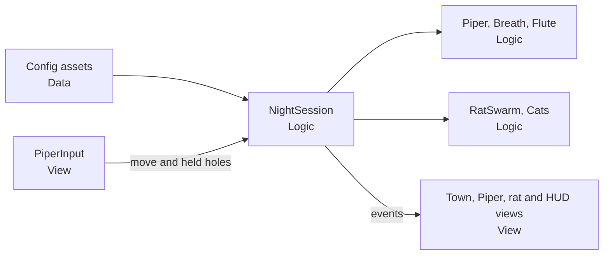

# Features

The team's shared tracker. Read it before starting work, and keep your row current while you work.

**Concept:** The Piper (החלילן). Lead the rats of Hamelin to the river with a six-hole flute before dawn.

## Board

| ID | Feature | Status | Owner | Branch | Holding | Verified by |
|---|---|---|---|---|---|---|
| F-001 | Choose the game concept | Done | Team | – | – | Team chose its HTML prototype, The Piper |
| F-002 | Add injection, advanced tools and fundamentals guides | Done | EldadStyleZ | `feature/F-002-engineering-guides` | – | 49 EditMode and 21 PlayMode tests in Unity batch mode on a scratch project |
| F-003 | Lead the rats to the river | Done | EldadStyleZ | `feature/F-003-rats-to-river` | – | 94 EditMode and 10 PlayMode tests in the Editor; Play Mode check with real keyboard and mouse (walking, charming, drowning, status); layout and ending seen in Play Mode captures |
| F-004 | Cats and songs | Done | EldadStyleZ | `feature/F-004-cats-and-songs` | – | 207 EditMode and 17 PlayMode tests in the Editor; the owner played it with real keys and the nine songs, combos row and cat all worked |
| F-005 | Menus and HUD | Done | EldadStyleZ | `feature/F-005-menus-and-hud` | – | 224 EditMode and 61 PlayMode tests in the Editor; the owner played it with real keys and mouse and the screens, pause, retry, flute and minimap all worked |
| F-006 | Night, effects and sound | Planned | EldadStyleZ | – | – | – |

- **Status:** `Idea`, `Planned`, `In progress`, `Done` or `Dropped`.
- **Holding:** the scenes and prefabs the owner is changing. Nobody else edits them until this cell is cleared, because Unity scenes merge badly.
- **Verified by:** what was actually run, such as `EditMode tests, Play Mode check`.

To claim work, set the owner, status and holding, then commit `FEATURES.md` alone straight to `main`. To finish, the pull request sets `Done`, fills in `Verified by` and clears `Holding`, so merging it releases the scenes.

## Feature notes

Copy this block for each feature once it is planned.

```markdown
### F-000: Feature name

- **Goal:** what the player gets, in one sentence.
- **Done when:** what someone can see or test.
- **Layers:** what changes in Data, Logic and View.
- **Tests:** the behaviours the tests prove.
- **Notes:** anything the next person should know.
```

### Porting The Piper

F-003 to F-006 rebuild the team's HTML prototype (`hamelin mechanics.html`, kept outside the repo) one playable slice at a time. We keep its rules and numbers, not its structure.



| Prototype | Our version |
|---|---|
| One file with global state | `View → Logic → Data` assemblies |
| Numbers in code | Config assets |
| `Math.random()` and `performance.now()` | Injected `IRandomSource`, with game time passed in |
| `if (id === 'conga')` chain | One strategy asset per song |
| Text states such as `'play'` | State machine |
| Effects created inside the rules | Logic raises events and View shows them |
| `setTimeout` for sounds | Coroutines in View |
| HTML and CSS | UI Toolkit |

**Left out on purpose:**

- `doShriek`, rat `fear`, `shriekReq` and `fluteHeld`, because nothing in the prototype reaches them.
- Levels, level select, unlocks and saved progress, because the game is one night.

**Fixed while porting:**

- The song note window used wall-clock time, so pausing expired notes. It uses game time.
- The balloon song left conga and heart timers frozen, so rats went back to an old formation after popping. A rat now holds one song at a time, so a new song replaces the old one.
- Fainting rats and sleeping cats slowed once per frame, so frame rate changed them. They now slow by time, and the tuned numbers keep their meaning at 60 frames a second.

**Shared decisions:**

- Logic keeps the prototype's coordinates and units, so its tuning numbers carry over unchanged. One View function maps them to the scene.
- Rats use our own rules, not `Rigidbody2D`, so tests run without a scene.
- The simulation ticks in `Update` with `deltaTime` capped at 0.033, as the prototype does.
- Input stays on the Input Manager behind `PiperInput`. Moving to the Input System package is a team decision, and only that class would change.
- The prototype has no image or audio files. We generate replaceable placeholder sprites, so art can be swapped without code changes.
- Game text is in English. The UI and theme may differ from the prototype, because the team may change them later.
- The night uses the numbers of the prototype's second level: 170 rats, a quota of 115 and 150 seconds. It is the first with a cat, and one asset holds the numbers, so they are easy to change.

### F-003: Lead the rats to the river

- **Goal:** the player walks the Piper through a generated town, charms rats with the flute and leads them into the river before dawn.
- **Done when:** in Play Mode, holding hole 1 near rats makes them follow, rats that cross the bank drown, and the night is won at the quota and lost at dawn.
- **Layers:** Data holds town, night, Piper, breath, flute and rat configs. Logic holds the seeded town generator, river bank, house collision, breath, flute modes, Piper movement, rat swarm and night session. View holds the composition root, input, camera and the town, Piper and rat views.
- **Tests:** town generator and river curve match values captured from the prototype; house collision; breath drain, exhaustion and recovery; which held hole wins; flute mode radii; Piper speed and river limit; rat charm rise, decay and spread; rat speed cap; drowning; win, unreachable quota and dawn endings; a simulation step allocates nothing.
- **Notes:** also replaces the `AGENTS.md` line that says the concept is not final.

### F-004: Cats and songs

- **Goal:** cats hunt rats, and note sequences cast the nine songs.
- **Done when:** in Play Mode, a cat eats rats, holes 5 and 6 drive it off, and every song casts from its keys.
- **Layers:** Data holds cat config, song definitions and HUD config. Logic holds cat behaviour, the song matcher, one `SongEffect` strategy per song and one `RatTrance` per kind of hold on a rat. View holds the cat view, song effect visuals and the combos row, which lists each song's keys.
- **Tests:** cat patrol, hunt, eat pause, flee and sleep; longest sequence matches first; the three-second note window in game time; cooldowns; each song's effect.
- **Notes:** the combos row ships here, with the rules, so every combo it shows really casts. The on-screen flute stays in F-005. Holes pressed in the same frame are read lowest first, so a very fast descending roll can miss its combo at a low frame rate.

### F-005: Menus and HUD

- **Goal:** the full game flow in English, from the title screen to the result screen.
- **Done when:** a player can read how to play, start the night, pause, see the result and retry.
- **Layers:** Data holds text assets. Logic holds the game flow state machine. View holds the UI Toolkit screens, on-screen flute, HUD and minimap.
- **Tests:** flow transitions, plus a PlayMode test that the screens load.
- **Notes:** `UIDocument` is built in, so no package is needed. The prototype's Hebrew text is translated to English and kept in text assets. Retry and quitting reload the scene, so every night starts clean, and both go through the title. The game also pauses when it loses focus, because it stops then anyway. Touch is not tested.

### F-006: Night, effects and sound

- **Goal:** the game's night mood and sound.
- **Done when:** lamps light a dark town, the sky warms towards dawn, and notes, ripples, rings, the flute and sound effects all play.
- **Layers:** Data holds effect and audio configs. Logic only exposes the dawn value. View holds the darkness overlay, pooled effects and generated flute sound.
- **Tests:** the dawn value, plus a Profiler check at the full rat count.
- **Notes:** the prototype's mute button and its moving moon-and-sun bar wait for this feature, because they need sound and the dawn value.

## Ideas

Not approved work. Do not build on these until they move to the board.

- None right now.

## Decisions

Add a row when the team decides something that future work must follow.

| Date | Decision | Why |
|---|---|---|
| 2026-10-30 | Layer code as `View → Logic → Data`, with one assembly per layer. | Keeps game rules testable and turns a wrong dependency into a compile error. |
| 2026-10-30 | Keep tunable values in ScriptableObjects. | Lets anyone change the game's feel without touching code. |
| 2026-10-30 | Merge code through reviewed pull requests. Only `FEATURES.md` claims go straight to `main`. | Keeps `main` working while making claims visible at once. |
| 2026-10-30 | Add new packages only by team decision. | Each package adds build size, risk and upkeep. |
| 2026-10-30 | Inject dependencies by hand, with one composition root per scene. No DI container for now. | Keeps Logic testable without adding a package. |
| 2026-10-31 | The game is The Piper, rebuilt from the team's HTML prototype to our standards. | The prototype already defines the rules, so we keep them and replace the structure. |
| 2026-10-31 | The game is one night, with no levels, unlocks or saved progress. | The team does not want levels. |
