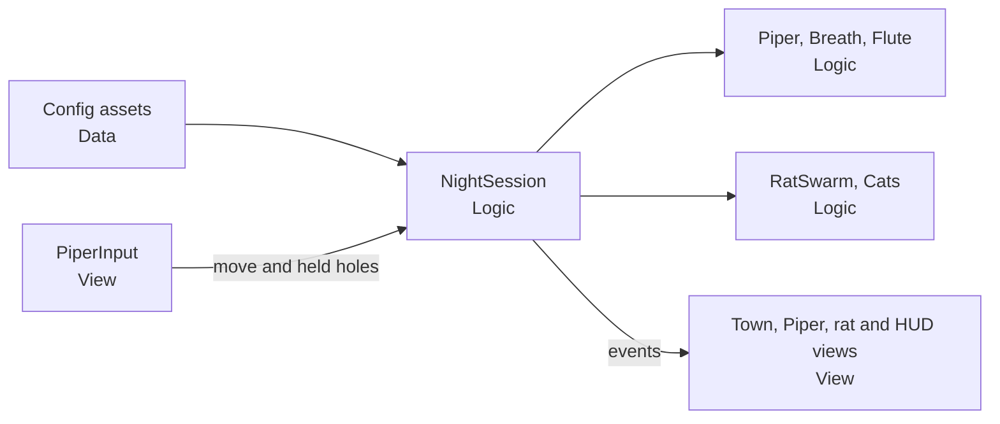

# Features

The team's shared tracker. Read it before starting work, and keep your row current while you work.

**Concept:** The Piper (החלילן). Lead the rats of Hamelin to the river with a six-hole flute before dawn.

## Board

| ID | Feature | Status | Owner | Branch | Holding | Verified by |
|---|---|---|---|---|---|---|
| F-001 | Choose the game concept | Done | Team | – | – | Team chose its HTML prototype, The Piper |
| F-002 | Add injection, advanced tools and fundamentals guides | Done | EldadStyleZ | `feature/F-002-engineering-guides` | – | 49 EditMode and 21 PlayMode tests in Unity batch mode on a scratch project |
| F-003 | Lead the rats to the river | Done | EldadStyleZ | `feature/F-003-rats-to-river` | – | 94 EditMode and 10 PlayMode tests in the Editor; Play Mode check with real keyboard and mouse (walking, charming, drowning, status); layout and ending seen in Play Mode captures |
| F-004 | Cats and songs | Done | EldadStyleZ | `feature/F-004-cats-and-songs` | – | 207 EditMode and 17 PlayMode tests in the Editor; the owner played it with real keys and the nine songs, combos row and cat all worked |
| F-005 | Menus and HUD | Done | EldadStyleZ | `feature/F-005-menus-and-hud` | – | 224 EditMode and 61 PlayMode tests in the Editor; the owner played it with real keys and mouse and the screens, pause, retry, flute and minimap all worked |
| F-006 | Night, effects and sound | Done | EldadStyleZ | `feature/F-006-night-effects-sound` | – | 247 EditMode and 156 PlayMode tests in the Editor; the owner played and listened and the flute, effects, mute and night look all worked; Profiler at 170 rats with all effects on: 1.32 ms average and 2.35 ms worst per frame in the Editor, 0.197 ms per rule tick |
| F-007 | Eldad's lab: summoner in a maze | In progress | EldadStyleZ | `eldad-lab` | `Assets/_Project/Scenes/eldad-lab-scene.unity` | – |
| F-008 | The toy for the course showing | In progress | EldadStyleZ | `toy-final` | `Assets/_Project/Scenes/Toy.unity` | 29 EditMode and 48 PlayMode tests in the Editor, PlayMode passing three runs in a row; 30 deliberate rule breakages were all caught; the music's glow and waves and the disco lights checked in captured Play Mode frames; the team's art seen in Play Mode: the field and its edge, ten obstacles, frogs, the Piper, musical notes in each hole's colour and the flute showing each hole; with all 20 frogs in Play Mode the conga line formed 1.8 seconds after the song, 0.63 to 0.74 apart, and danced 9 seconds from then, and the heart formed after 2.7 seconds with 4 frogs stuck against obstacles and held 7 seconds from then, with no console errors. The R restart was checked through the method the key calls and the key setting; a real key press was not simulated |
| F-009 | Space Party Game | In progress | oisin | `feature/F-009-space-party-game` | `Assets/_Project/SpacePartyGame/Scenes/Space Party Game.unity` | – |

- **Status:** `Idea`, `Planned`, `In progress`, `Done` or `Dropped`.
- **Holding:** the scenes and prefabs the owner is changing. Nobody else edits them until this cell is cleared, because Unity scenes merge badly.
- **Verified by:** what was actually run, such as `EditMode tests, Play Mode check`.

To claim work, set the owner, status and holding, then commit `FEATURES.md` alone straight to `main`. To finish, the pull request sets `Done`, fills in `Verified by` and clears `Holding`, so merging it releases the scenes.

## Feature notes

Copy this block for each feature once it is planned.

```markdown
### F-000: Feature name

- **Goal:** what the player gets, in one sentence.
- **Done when:** what someone can see or test.
- **Layers:** what changes in Data, Logic and View.
- **Tests:** the behaviours the tests prove.
- **Notes:** anything the next person should know.
```

### Porting The Piper

F-003 to F-006 rebuild the team's HTML prototype (`hamelin mechanics.html`, kept outside the repo) one playable slice at a time. We keep its rules and numbers, not its structure.



| Prototype | Our version |
|---|---|
| One file with global state | `View → Logic → Data` assemblies |
| Numbers in code | Config assets |
| `Math.random()` and `performance.now()` | Injected `IRandomSource`, with game time passed in |
| `if (id === 'conga')` chain | One strategy asset per song |
| Text states such as `'play'` | State machine |
| Effects created inside the rules | Logic raises events and View shows them |
| `setTimeout` for sounds | Coroutines in View |
| HTML and CSS | UI Toolkit |

**Left out on purpose:**

- `doShriek`, rat `fear`, `shriekReq` and `fluteHeld`, because nothing in the prototype reaches them.
- Levels, level select, unlocks and saved progress, because the game is one night.

**Fixed while porting:**

- The song note window used wall-clock time, so pausing expired notes. It uses game time.
- The balloon song left conga and heart timers frozen, so rats went back to an old formation after popping. A rat now holds one song at a time, so a new song replaces the old one.
- Fainting rats and sleeping cats slowed once per frame, so frame rate changed them. They now slow by time, and the tuned numbers keep their meaning at 60 frames a second.

**Shared decisions:**

- Logic keeps the prototype's coordinates and units, so its tuning numbers carry over unchanged. One View function maps them to the scene.
- Rats use our own rules, not `Rigidbody2D`, so tests run without a scene.
- The simulation ticks in `Update` with `deltaTime` capped at 0.033, as the prototype does.
- Input stays on the Input Manager behind `PiperInput`. Moving to the Input System package is a team decision, and only that class would change.
- The prototype has no image or audio files. We generate replaceable placeholder sprites, so art can be swapped without code changes.
- Game text is in English. The UI and theme may differ from the prototype, because the team may change them later.
- The night uses the numbers of the prototype's second level: 170 rats, a quota of 115 and 150 seconds. It is the first with a cat, and one asset holds the numbers, so they are easy to change.

### F-003: Lead the rats to the river

- **Goal:** the player walks the Piper through a generated town, charms rats with the flute and leads them into the river before dawn.
- **Done when:** in Play Mode, holding hole 1 near rats makes them follow, rats that cross the bank drown, and the night is won at the quota and lost at dawn.
- **Layers:** Data holds town, night, Piper, breath, flute and rat configs. Logic holds the seeded town generator, river bank, house collision, breath, flute modes, Piper movement, rat swarm and night session. View holds the composition root, input, camera and the town, Piper and rat views.
- **Tests:** town generator and river curve match values captured from the prototype; house collision; breath drain, exhaustion and recovery; which held hole wins; flute mode radii; Piper speed and river limit; rat charm rise, decay and spread; rat speed cap; drowning; win, unreachable quota and dawn endings; a simulation step allocates nothing.
- **Notes:** also replaces the `AGENTS.md` line that says the concept is not final.

### F-004: Cats and songs

- **Goal:** cats hunt rats, and note sequences cast the nine songs.
- **Done when:** in Play Mode, a cat eats rats, holes 5 and 6 drive it off, and every song casts from its keys.
- **Layers:** Data holds cat config, song definitions and HUD config. Logic holds cat behaviour, the song matcher, one `SongEffect` strategy per song and one `RatTrance` per kind of hold on a rat. View holds the cat view, song effect visuals and the combos row, which lists each song's keys.
- **Tests:** cat patrol, hunt, eat pause, flee and sleep; longest sequence matches first; the three-second note window in game time; cooldowns; each song's effect.
- **Notes:** the combos row ships here, with the rules, so every combo it shows really casts. The on-screen flute stays in F-005. Holes pressed in the same frame are read lowest first, so a very fast descending roll can miss its combo at a low frame rate.

### F-005: Menus and HUD

- **Goal:** the full game flow in English, from the title screen to the result screen.
- **Done when:** a player can read how to play, start the night, pause, see the result and retry.
- **Layers:** Data holds text assets. Logic holds the game flow state machine. View holds the UI Toolkit screens, on-screen flute, HUD and minimap.
- **Tests:** flow transitions, plus a PlayMode test that the screens load.
- **Notes:** `UIDocument` is built in, so no package is needed. The prototype's Hebrew text is translated to English and kept in text assets. Retry and quitting reload the scene, so every night starts clean, and both go through the title. The game also pauses when it loses focus, because it stops then anyway. Touch is not tested.

### F-006: Night, effects and sound

- **Goal:** the game's night mood and sound.
- **Done when:** lamps light a dark town, the sky warms towards dawn, and notes, ripples, rings, the flute and sound effects all play.
- **Layers:** Data holds effect and audio configs. Logic only exposes the dawn value. View holds the darkness overlay, pooled effects and generated flute sound.
- **Tests:** the dawn value, plus a Profiler check at the full rat count.
- **Notes:** the prototype's mute button and its moving moon-and-sun bar ship here, because they need sound and the dawn value. Changing audio device stops every source and empties clips made in code, so the flute restarts and the effects bake again. Unity's first read of the listener is blank even with sound playing, so PlayMode tests read it through `ListenerMeter`. Disco lights keep orbiting during Pause, as in the prototype. Left out on purpose: cobblestones, roof detail, water flow lines, a detailed Piper, rat tails and eye glints, and the March target line. Touch is not tested.

### F-008: The toy for the course showing

- **Goal:** show the course the toy at the heart of The Piper: the Piper's flute and the rats that listen to it, with no goal, timer or counter.
- **Done when:** in `Toy.unity` the Piper walks a plain field, holding 1 and 2 calls rats, 3 and 4 marches them and 5 and 6 scares them, the eight rat songs from the old game work from their combos, and the combos row and the on-screen flute show it all.
- **Layers:** on purpose, this branch does not use the `Data`, `Logic` and `View` layers. The team asked for the standard Unity way it can follow: GameObjects with components wired in the Inspector, a Rat prefab, one ScriptableObject per song, and real sprite, sound, animation and UI files. `Assets/_Project/README.md` explains every object and script.
- **Tests:** combos find the right song in time; walking and the field's edge; calling, marching and scaring near rats but not far ones; every song gives the rats in reach its mood; songs rest; Crowd Surf lifts the Piper; Balloons float over the others; the combos row and the flute bar.
- **Team notes, round one:** the Piper walks through the rats instead of shoving them, because each rat ignores the Piper's collider. Crowd Surf gathers the rats in reach into a crowd under the Piper, and the crowd moves exactly as the Piper does, so the player steers it. The how-to-play line is gone. The flute plays live through the old game's synthesizer, so a released note fades out over 0.05 seconds instead of cutting off, and the six note files are gone. The Piper eases into its turns. Balloon rats stop walking and waddling and rise slowly up the screen and a little right, staying inside the field.
- **Team art, round two:** the team's drawings replace the placeholders: the Piper, frogs for the rats (the code still says rats), a blob-shaped field whose Edge Collider 2D follows the drawn outline, notch included, an upright flute that shows the hole being played, and the team's shapes 1, 2, 4, 5 and 6 standing on the field as obstacles, two of each, 3 to 5 units across, each with a Polygon Collider 2D that stops both the Piper and the frogs. They stand clear of the middle, of the edge and of each other, and a rat never starts inside one. The music floating from the Piper is the old game's notes again, in the colour of the hole being played. The drawings were 9922 by 9922 pixels, mostly empty, so `Tools/toy-art/prepare_art.py` trims and shrinks them; the originals stay outside the repo. Balloon rats now keep their collider, because a curved edge would otherwise let them float off the field and stay outside after they pop.
- **Conga and heart, round three:** the conga line follows the Piper's footsteps: `CongaLine` records where the Piper walks, and each rat stands its own distance back along that path, 0.7 units apart (`RatHerd` › Conga Gap), so the rats go one after another round corners instead of swinging in a stiff row behind the Piper's back. The line starts straight behind the Piper, or swung aside if an obstacle or the edge is in the way, and the rats nearest the Piper's back take the first places. Every rat runs to its place at once, faster than the Piper walks (`Rat` › Formation Speed). The conga and the heart are formations: their song's seconds only start counting when every rat in them is at its place, or has not got any closer for a second (`Rat` › Stuck Seconds), for example because an obstacle stands on its heart spot. Heart spots go to the nearest free rat, so rats cross less. The earlier extra 0.6 seconds per rat is gone, because the wait for the formation replaces it.
- **Team notes, round four:** disco rats used to run round a small circle while their body spun, so they seemed to whirl round a point beside them; now they stand still and spin round their own middle, half of them each way. Under each one a soft light (`Rat` › Disco Light) holds one of the flute's six hole colours for half a second, then fades into the next (`DiscoPalette`), each rat starting on its own colour, and the rat takes on a little of it, instead of the old rainbow flicker. The gold ring is replaced by `MusicRing`: a soft glow in the held hole's colour, the same as the notes, whose drawn edge sits exactly at the hearing radius, with waves rolling out to it, fading in and out instead of popping. `Tools/toy-art/make_glows.py` draws the glow, the wave and the disco light. Once every Crowd Surf rat is inside the crowd's circle under the Piper, or stuck, the Piper and its crowd move at twice the walking speed (`PiperMovement` › Carried Speed Factor) until the crowd lets go. R restarts the toy by loading the scene again (`Game` › `RestartKey`).
- **Notes:** `toy-final` holds only the toy; the old game, its scene and its 115 scripts stay on `main`. Lullaby is left out because it only puts cats to sleep and the toy has no cats. A song's last note is often a scare hole, so rats ignore the flute for half a second after a song, or Dance and Crowd Surf would scare away the rats they just charmed. The sounds come from `Tools/toy-sounds/make_sounds.py`, which copies the old game's flute pitches and song jingles.

### F-009: Space Party Game

- **Goal:** a new scene, Space Party Game, built from the team's `inGameSprites.zip` art: an astronaut with a flute, vermin and six coloured cages.
- **Done when:** to be planned step by step; `Assets/_Project/SpacePartyGame/NOTES.md` holds the ground rules and decisions.
- **Layers:** everything new lives under `Assets/_Project/SpacePartyGame/`. The flute reuses the toy's `FluteSynth` and `FluteVoice` by reference, without copying or changing them.
- **Notes:** built on `Oisin-prototype`, which holds the toy, not on `main`. Adds `com.unity.inputsystem` with Active Input Handling set to Both, so existing scenes keep the old input.

## Ideas

Not approved work. Do not build on these until they move to the board.

- None right now.

## Decisions

Add a row when the team decides something that future work must follow.

| Date | Decision | Why |
|---|---|---|
| 2026-10-30 | Layer code as `View → Logic → Data`, with one assembly per layer. | Keeps game rules testable and turns a wrong dependency into a compile error. |
| 2026-10-30 | Keep tunable values in ScriptableObjects. | Lets anyone change the game's feel without touching code. |
| 2026-10-30 | Merge code through reviewed pull requests. Only `FEATURES.md` claims go straight to `main`. | Keeps `main` working while making claims visible at once. |
| 2026-10-30 | Add new packages only by team decision. | Each package adds build size, risk and upkeep. |
| 2026-10-30 | Inject dependencies by hand, with one composition root per scene. No DI container for now. | Keeps Logic testable without adding a package. |
| 2026-10-31 | The game is The Piper, rebuilt from the team's HTML prototype to our standards. | The prototype already defines the rules, so we keep them and replace the structure. |
| 2026-10-31 | The game is one night, with no levels, unlocks or saved progress. | The team does not want levels. |
| 2026-11-10 | Add the Input System package (`com.unity.inputsystem`) and set Active Input Handling to Both. Decided by oisin for F-009. | The Space Party Game uses the new Input System, and Both keeps existing scenes on the old input working. |
