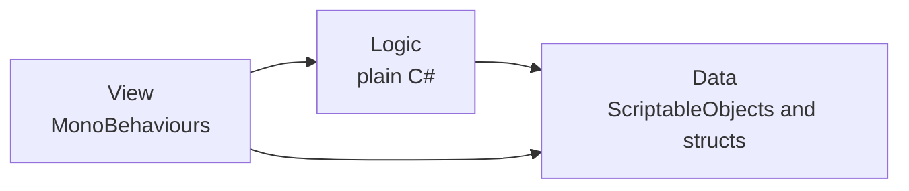

# Coding Standards

How we write C# in this project. `AGENTS.md` has the workflow and hard rules, and `.editorconfig` applies naming and formatting in Rider and Visual Studio. `docs/FUNDAMENTALS.md` explains the OOP and Unity ideas behind these rules.

You may break a rule here for a good reason. Put the reason in a code comment and in the pull request.

## 1. Principles

1. **Readable first.** A teammate should understand a class without asking you.
2. **One job each.** Every class and method has one reason to change. If describing it needs the word "and", split it.
3. **Data drives behaviour.** Numbers, tuning and content live in assets, not in code.
4. **Add by plugging in.** A new variant is a new asset or class, not another `case` in a `switch`.
5. **Simple beats clever.** Build what the feature needs today. Add an abstraction at the second real use, not the first imagined one.
6. **Fail loudly.** Bad setup gives a clear error in the Editor, not quietly wrong behaviour.

## 2. Architecture



| Layer | Holds | Rules |
|---|---|---|
| **Data** | ScriptableObject configs, event channels, plain structs, enums | Knows nothing about Logic or View. No game rules. |
| **Logic** | Game rules: state, calculations, decisions, state machines | Plain C# classes. May use Data, `Mathf` and `Vector3`. No `GameObject`, `Transform`, `Time` or input. Takes `deltaTime` and input as parameters so tests control them. |
| **View** | MonoBehaviours for input, physics, animation, audio and UI | Forwards what happened to Logic and shows the result. An `if` about a game rule belongs in Logic. |

A small script that only spins an object can be View alone. Do not create empty layers.

### Choosing the right tool

| Problem | Use | Avoid |
|---|---|---|
| Tuning values and content | ScriptableObject asset | Numbers in code |
| Something with modes | State machine | A pile of `bool` flags |
| Reacting to an event | C# event or event channel | Checking in `Update` |
| One system telling another | Event channel asset | `Find` methods, singletons |
| A class needs a service, randomness, time or storage | Dependency injection | Creating it inside the class, `static` access |
| Several versions of a behaviour | Interface or ScriptableObject strategy | `switch` on a type |
| Objects spawned often | `ObjectPool<T>` | `Instantiate` and `Destroy` every few frames |
| Short timed sequences | Coroutine or `Awaitable` | Timer fields in `Update` |
| Thousands of objects | Profile first, then Jobs and Burst | ECS by default |

## 3. Assemblies and namespaces

The folder layout is in `AGENTS.md`. Each layer is an assembly, so a wrong dependency cannot compile.

| Assembly | References |
|---|---|
| `DigitalStory.Data` | None |
| `DigitalStory.Logic` | `Data` |
| `DigitalStory.View` | `Data`, `Logic` |
| `DigitalStory.Editor` | `Data`, `Logic`, `View`. Editor platform only. |
| `DigitalStory.Tests.EditMode` | `Data`, `Logic`, plus Unity's test assemblies |
| `DigitalStory.Tests.PlayMode` | `Data`, `Logic`, `View`, plus Unity's test assemblies |

```json
{
    "name": "DigitalStory.Logic",
    "rootNamespace": "DigitalStory.Logic",
    "references": ["DigitalStory.Data"],
    "autoReferenced": false
}
```

The namespace matches the assembly, such as `DigitalStory.Logic`. Feature folders do not add to it. `DigitalStory` stays as the root name even if the game gets a different title.

## 4. Naming

| Item | Style | Example |
|---|---|---|
| Classes, structs, enums | `PascalCase` noun | `EnemySpawner` |
| Interfaces | `I` + `PascalCase` | `IDamageable` |
| Methods | `PascalCase` verb | `ApplyDamage` |
| Properties, constants, `static readonly` | `PascalCase` | `MaxSpeed` |
| Private fields, including serialized | `_camelCase` | `_moveSpeed` |
| Parameters and locals | `camelCase` | `damageAmount` |
| Booleans | Reads as a question | `IsAlive`, `HasKey`, `CanJump` |
| Events | Past tense | `Died`, `ScoreChanged` |
| Event handlers | `Handle` + event | `HandleDied` |
| Async methods | Ends in `Async` | `LoadLevelAsync` |
| Assets | `PascalCase`, type last | `PlayerHealthConfig` |

Spell words out: `damagePerSecond`, not `dps`. Common game terms such as `Hp`, `Xp`, `Ui` and `Vfx` are fine.

## 5. Writing classes

- One public type per file, and the file name matches the type.
- Write access modifiers every time: `private void Awake()`, not `void Awake()`.
- Make classes `sealed` unless they are designed to be inherited.
- Order members: constants, serialized fields, private fields, properties, events, Unity messages in the order Unity calls them, public methods, private methods.
- Keep methods short, with one level of abstraction. Return early instead of nesting.
- Name your numbers. A tunable goes in Data, and a fixed value becomes a `const`.
- Always use braces, even for one line.
- Prefer composition: several small components over one large class, and interfaces over deep inheritance.
- Comments explain why, not what. If a comment explains what, rename something instead.
- Public APIs get XML doc comments, because they appear in teammates' IntelliSense.

## 6. Worked example

One small feature across all three layers.

**Data:** tuning values in an asset.

```csharp
// Assets/_Project/Scripts/Data/Health/HealthConfig.cs
using UnityEngine;

namespace DigitalStory.Data
{
    /// <summary>Tuning values shared by everything using this health setup.</summary>
    [CreateAssetMenu(menuName = "DigitalStory/Health Config", fileName = "HealthConfig")]
    public sealed class HealthConfig : ScriptableObject
    {
        [field: SerializeField, Min(1), Tooltip("Health at spawn.")]
        public int MaxHealth { get; private set; } = 100;
    }
}
```

**Logic:** the rules, with no scene needed.

```csharp
// Assets/_Project/Scripts/Logic/Health/Health.cs
using System;

namespace DigitalStory.Logic
{
    /// <summary>Tracks current health and announces changes.</summary>
    public sealed class Health
    {
        public Health(int max)
        {
            if (max <= 0)
            {
                throw new ArgumentOutOfRangeException(nameof(max), max, "Max health must be positive.");
            }

            Max = max;
            Current = max;
        }

        public event Action<int> Changed;
        public event Action Died;

        public int Max { get; }
        public int Current { get; private set; }
        public bool IsAlive => Current > 0;

        public void TakeDamage(int amount)
        {
            if (amount < 0)
            {
                throw new ArgumentOutOfRangeException(nameof(amount), amount, "Damage cannot be negative.");
            }

            if (amount == 0 || !IsAlive)
            {
                return;
            }

            Current = Math.Max(0, Current - amount);
            Changed?.Invoke(Current);

            if (!IsAlive)
            {
                Died?.Invoke();
            }
        }
    }
}
```

**View:** a thin link to the GameObject.

```csharp
// Assets/_Project/Scripts/View/Health/HealthComponent.cs
using DigitalStory.Data;
using DigitalStory.Logic;
using UnityEngine;
using UnityEngine.Events;

namespace DigitalStory.View
{
    /// <summary>Gives a GameObject health and exposes its death to the Inspector.</summary>
    [DisallowMultipleComponent]
    [AddComponentMenu("DigitalStory/Health")]
    public sealed class HealthComponent : MonoBehaviour
    {
        [Header("Data")]
        [SerializeField, Tooltip("Asset with the tuning values.")]
        private HealthConfig _config;

        [Header("Reactions")]
        [SerializeField, Tooltip("Hook up effects and sound here without code.")]
        private UnityEvent _died = new UnityEvent();

        private Health _health;

        public Health Health => _health;

        private void Awake()
        {
            if (_config == null)
            {
                // Passing "this" means clicking the log selects this object.
                Debug.LogError($"{name}: HealthComponent has no config.", this);
                enabled = false;
                return;
            }

            _health = new Health(_config.MaxHealth);
        }

        private void OnEnable()
        {
            if (_health != null)
            {
                _health.Died += HandleDied;
            }
        }

        private void OnDisable()
        {
            // Unity also calls this when Awake disables the component, so _health can be null.
            if (_health != null)
            {
                _health.Died -= HandleDied;
            }
        }

        private void OnValidate()
        {
            if (_config == null)
            {
                Debug.LogWarning($"{name}: assign a HealthConfig.", this);
            }
        }

        [ContextMenu("Debug/Take 10 Damage")]
        private void DebugTakeDamage() => _health?.TakeDamage(10);

        private void HandleDied() => _died.Invoke();
    }
}
```

**Test:** the rules, proven without entering Play Mode.

```csharp
// Assets/_Project/Tests/EditMode/Health/HealthTests.cs
using DigitalStory.Logic;
using NUnit.Framework;

namespace DigitalStory.Tests.EditMode
{
    public sealed class HealthTests
    {
        [TestCase(30, 70)]
        [TestCase(100, 0)]
        [TestCase(250, 0)]
        public void TakeDamage_AnyAmount_NeverGoesBelowZero(int damage, int expected)
        {
            var health = new Health(100);

            health.TakeDamage(damage);

            Assert.That(health.Current, Is.EqualTo(expected));
        }

        [Test]
        public void TakeDamage_WhenAlreadyDead_DoesNotRaiseDiedAgain()
        {
            var health = new Health(10);
            var diedCount = 0;
            health.Died += () => diedCount++;

            health.TakeDamage(10);
            health.TakeDamage(10);

            Assert.That(diedCount, Is.EqualTo(1));
        }
    }
}
```

## 7. Common patterns

**Event channel:** lets systems react to the same moment without knowing each other. Create one asset per event and assign it in the Inspector.

```csharp
// Assets/_Project/Scripts/Data/Events/EventChannel.cs
using System;
using UnityEngine;

namespace DigitalStory.Data
{
    /// <summary>A named event that senders and listeners share as an asset.</summary>
    [CreateAssetMenu(menuName = "DigitalStory/Event Channel", fileName = "EventChannel")]
    public sealed class EventChannel : ScriptableObject
    {
        public event Action Raised;

        public void Raise() => Raised?.Invoke();
    }
}
```

**State machine:** one class per state. Adding a state does not touch the others.

```csharp
// Assets/_Project/Scripts/Logic/States/IState.cs
namespace DigitalStory.Logic
{
    /// <summary>One mode of a behaviour.</summary>
    public interface IState
    {
        void Enter();
        void Tick(float deltaTime);
        void Exit();
    }
}
```

```csharp
// Assets/_Project/Scripts/Logic/States/StateMachine.cs
namespace DigitalStory.Logic
{
    /// <summary>Runs one state at a time.</summary>
    public sealed class StateMachine
    {
        public IState Current { get; private set; }

        public void ChangeTo(IState next)
        {
            Current?.Exit();
            Current = next;
            Current?.Enter();
        }

        public void Tick(float deltaTime) => Current?.Tick(deltaTime);
    }
}
```

**Object pool:** reuses objects instead of creating garbage.

```csharp
// Assets/_Project/Scripts/View/Spawning/PooledSpawner.cs
using UnityEngine;
using UnityEngine.Pool;

namespace DigitalStory.View
{
    /// <summary>Spawns and reuses instances of one prefab.</summary>
    public sealed class PooledSpawner : MonoBehaviour
    {
        [SerializeField, Tooltip("Prefab to reuse.")]
        private GameObject _prefab;

        private ObjectPool<GameObject> _pool;

        private void Awake()
        {
            _pool = new ObjectPool<GameObject>(
                createFunc: () => Instantiate(_prefab),
                actionOnGet: instance => instance.SetActive(true),
                actionOnRelease: instance => instance.SetActive(false),
                actionOnDestroy: instance => Destroy(instance));
        }

        public GameObject Spawn() => _pool.Get();

        public void Despawn(GameObject instance) => _pool.Release(instance);
    }
}
```

**Async:** use `Awaitable` with `destroyCancellationToken`, so waiting stops when the object is destroyed.

```csharp
// Assets/_Project/Scripts/View/Effects/HitFlash.cs
using System;
using UnityEngine;

namespace DigitalStory.View
{
    /// <summary>Hides a renderer briefly as a hit effect.</summary>
    [RequireComponent(typeof(Renderer))]
    public sealed class HitFlash : MonoBehaviour
    {
        [SerializeField, Min(0f), Tooltip("Seconds the object stays hidden.")]
        private float _duration = 0.1f;

        private Renderer _renderer;

        private void Awake() => _renderer = GetComponent<Renderer>();

        public async Awaitable PlayAsync()
        {
            _renderer.enabled = false;

            try
            {
                await Awaitable.WaitForSecondsAsync(_duration, destroyCancellationToken);
                _renderer.enabled = true;
            }
            catch (OperationCanceledException)
            {
                // The object was destroyed mid-flash, so there is nothing to restore.
            }
        }
    }
}
```

## 8. Dependency injection

Give a class what it needs instead of letting it find or create it. Tests can then pass in a fake, and anyone can see what a class depends on.

We inject by hand, because hand wiring is enough for this game and needs no package. A container such as VContainer would be a new package, so it needs a team decision in `FEATURES.md`.

| Kind | How | Use for |
|---|---|---|
| Constructor | Pass it to `new` | Plain C# classes. This is the default. |
| Inspector | A `[SerializeField]` reference | ScriptableObjects, prefabs and scene objects |
| Method | An `Initialize` method | MonoBehaviours that need plain C# services, because Unity creates them and you cannot pass arguments to their constructor |

Inject services, randomness, time, storage and anything a test must control. Do not inject plain values, pure helpers such as `Mathf`, or a helper that only one class uses.

**Step 1: Logic declares what it needs.** The interface lives in Logic, so Logic never depends on Unity's version.

```csharp
// Assets/_Project/Scripts/Logic/Rolls/IRandomSource.cs
namespace DigitalStory.Logic
{
    /// <summary>Supplies random numbers, so tests can control them.</summary>
    public interface IRandomSource
    {
        /// <summary>Returns a whole number from the minimum up to, but not including, the maximum.</summary>
        int NextInt(int minInclusive, int maxExclusive);
    }
}
```

```csharp
// Assets/_Project/Scripts/Logic/Rolls/CriticalHitRule.cs
using System;

namespace DigitalStory.Logic
{
    /// <summary>Decides whether a hit is critical.</summary>
    public sealed class CriticalHitRule
    {
        private const int FullChance = 100;

        private readonly IRandomSource _random;
        private readonly int _chancePercent;

        public CriticalHitRule(IRandomSource random, int chancePercent)
        {
            if (chancePercent < 0 || chancePercent > FullChance)
            {
                throw new ArgumentOutOfRangeException(nameof(chancePercent), chancePercent, "Chance must be 0 to 100.");
            }

            _random = random ?? throw new ArgumentNullException(nameof(random));
            _chancePercent = chancePercent;
        }

        public bool Roll() => _random.NextInt(0, FullChance) < _chancePercent;
    }
}
```

**Step 2: A test passes in a fake.** The result no longer depends on luck.

```csharp
// Assets/_Project/Tests/EditMode/Rolls/CriticalHitRuleTests.cs
using DigitalStory.Logic;
using NUnit.Framework;

namespace DigitalStory.Tests.EditMode
{
    public sealed class CriticalHitRuleTests
    {
        [TestCase(24, true)]
        [TestCase(25, false)]
        public void Roll_ComparedToChance_IsCriticalOnlyBelowIt(int rolled, bool expected)
        {
            var rule = new CriticalHitRule(new FixedRandomSource(rolled), 25);

            Assert.That(rule.Roll(), Is.EqualTo(expected));
        }

        private sealed class FixedRandomSource : IRandomSource
        {
            private readonly int _value;

            public FixedRandomSource(int value) => _value = value;

            public int NextInt(int minInclusive, int maxExclusive) => _value;
        }
    }
}
```

**Step 3: View supplies the real version.**

```csharp
// Assets/_Project/Scripts/View/Rolls/UnityRandomSource.cs
using DigitalStory.Logic;
using UnityEngine;

namespace DigitalStory.View
{
    /// <summary>Random numbers from Unity's generator.</summary>
    public sealed class UnityRandomSource : IRandomSource
    {
        public int NextInt(int minInclusive, int maxExclusive) => Random.Range(minInclusive, maxExclusive);
    }
}
```

**Step 4: A MonoBehaviour takes dependencies through `Initialize`.**

```csharp
// Assets/_Project/Scripts/View/Rolls/Attacker.cs
using DigitalStory.Logic;
using UnityEngine;

namespace DigitalStory.View
{
    /// <summary>Rolls for critical hits on behalf of a GameObject.</summary>
    [DisallowMultipleComponent]
    [AddComponentMenu("DigitalStory/Attacker")]
    public sealed class Attacker : MonoBehaviour
    {
        private CriticalHitRule _criticalHits;

        /// <summary>Supplies this attacker's rules. Call once, before the first attack.</summary>
        public void Initialize(CriticalHitRule criticalHits) => _criticalHits = criticalHits;

        public bool RollCritical()
        {
            Debug.Assert(_criticalHits != null, $"{name}: call Initialize before attacking.", this);
            return _criticalHits.Roll();
        }
    }
}
```

**Step 5: One composition root per scene connects everything.** Reading this class shows how the scene is wired.

```csharp
// Assets/_Project/Scripts/Data/Rolls/CriticalHitConfig.cs
using UnityEngine;

namespace DigitalStory.Data
{
    /// <summary>Tuning values for critical hits.</summary>
    [CreateAssetMenu(menuName = "DigitalStory/Critical Hit Config", fileName = "CriticalHitConfig")]
    public sealed class CriticalHitConfig : ScriptableObject
    {
        [field: SerializeField, Range(0, 100), Tooltip("Chance that a hit is critical.")]
        public int ChancePercent { get; private set; } = 10;
    }
}
```

```csharp
// Assets/_Project/Scripts/View/Composition/GameRoot.cs
using DigitalStory.Data;
using DigitalStory.Logic;
using UnityEngine;

namespace DigitalStory.View
{
    /// <summary>Creates this scene's services and hands them to the objects that need them.</summary>
    [DisallowMultipleComponent]
    [DefaultExecutionOrder(-1000)] // Runs before other scripts, so services exist before they start.
    [AddComponentMenu("DigitalStory/Game Root")]
    public sealed class GameRoot : MonoBehaviour
    {
        [SerializeField, Tooltip("Tuning values for critical hits.")]
        private CriticalHitConfig _criticalHitConfig;

        [SerializeField, Tooltip("Attackers placed in this scene.")]
        private Attacker[] _attackers = new Attacker[0];

        private void Awake()
        {
            if (_criticalHitConfig == null)
            {
                Debug.LogError($"{name}: GameRoot has no critical hit config.", this);
                return;
            }

            var random = new UnityRandomSource();
            var criticalHits = new CriticalHitRule(random, _criticalHitConfig.ChancePercent);

            foreach (Attacker attacker in _attackers)
            {
                attacker.Initialize(criticalHits);
            }
        }
    }
}
```

Rules for injection:

- Only the composition root creates services. It calls `Initialize` on scene objects.
- Code that spawns objects gets its dependencies from the composition root, and calls `Initialize` straight after `Instantiate`.
- Use injected dependencies from `Start` onward. `Instantiate` runs `Awake` and `OnEnable` before you can call `Initialize`.
- Do not pass the composition root around or add a global registry. That is a service locator, which hides dependencies again.

## 9. Advanced tools

Use these when the problem in the middle column is real. Each one adds something to learn, so the simple version wins when it is enough.

| Tool | Use when | Skip when |
|---|---|---|
| Interface | Two versions exist, or a test needs a fake | There is one version and no test needs another |
| ScriptableObject strategy | Designers choose a behaviour per asset | The behaviour never varies |
| Generic event channel | An event carries a value | It carries nothing, so use `EventChannel` |
| Command objects | Actions need queueing, buffering, rebinding, undo or replay | A direct method call is enough |
| `readonly struct` | Small values that never change, such as event data | The data is large or has its own identity |
| `ListPool<T>` | Per-frame code needs a temporary list | Startup code and editor tools |
| `InternalsVisibleTo` | A test needs a member that should not be public | The public API can prove the behaviour |
| `[SerializeReference]` | One asset needs a list of mixed plain classes | One ScriptableObject per variant works. It only holds plain `[Serializable]` classes, and you may need to write the Inspector UI for choosing a type. |
| Custom editor tools | The same setup mistake keeps happening | The task happens once |
| Jobs and Burst | The Profiler shows a heavy math loop | Anything else |
| DI container | Hand wiring across many scenes has become a real cost | Today. It needs a team decision. |

**ScriptableObject strategy:** each behaviour is an asset, so designers swap it in the Inspector. It holds a rule, so it lives in Logic even though it is a ScriptableObject. The base is an abstract class because Unity can only save a ScriptableObject as an asset, and an interface cannot be one.

```csharp
// Assets/_Project/Scripts/Logic/Targeting/TargetPicker.cs
using System.Collections.Generic;
using UnityEngine;

namespace DigitalStory.Logic
{
    /// <summary>A rule for choosing a target, saved as an asset.</summary>
    public abstract class TargetPicker : ScriptableObject
    {
        /// <summary>Returns the chosen index, or -1 when there are no targets.</summary>
        public abstract int Pick(IReadOnlyList<float> distances);
    }
}
```

```csharp
// Assets/_Project/Scripts/Logic/Targeting/NearestTargetPicker.cs
using System.Collections.Generic;
using UnityEngine;

namespace DigitalStory.Logic
{
    /// <summary>Chooses the closest target.</summary>
    [CreateAssetMenu(menuName = "DigitalStory/Target Pickers/Nearest", fileName = "NearestTargetPicker")]
    public sealed class NearestTargetPicker : TargetPicker
    {
        public override int Pick(IReadOnlyList<float> distances)
        {
            int nearestIndex = -1;
            float nearestDistance = float.MaxValue;

            for (int index = 0; index < distances.Count; index++)
            {
                if (distances[index] < nearestDistance)
                {
                    nearestDistance = distances[index];
                    nearestIndex = index;
                }
            }

            return nearestIndex;
        }
    }
}
```

**Generic event channel:** one class holds the logic, and each value type gets a small class, because Unity cannot create an asset from an open generic type.

```csharp
// Assets/_Project/Scripts/Data/Events/EventChannelOfT.cs
using System;
using UnityEngine;

namespace DigitalStory.Data
{
    /// <summary>A shared event that carries one value.</summary>
    public abstract class EventChannel<T> : ScriptableObject
    {
        public event Action<T> Raised;

        public void Raise(T value) => Raised?.Invoke(value);
    }
}
```

```csharp
// Assets/_Project/Scripts/Data/Events/IntEventChannel.cs
using UnityEngine;

namespace DigitalStory.Data
{
    /// <summary>An event channel that carries a whole number.</summary>
    [CreateAssetMenu(menuName = "DigitalStory/Int Event Channel", fileName = "IntEventChannel")]
    public sealed class IntEventChannel : EventChannel<int>
    {
    }
}
```

**Command objects:** turn an action into an object, so it can wait in a queue.

```csharp
// Assets/_Project/Scripts/Logic/Commands/ICommand.cs
namespace DigitalStory.Logic
{
    /// <summary>One action that can be stored and run later.</summary>
    public interface ICommand
    {
        void Execute();
    }
}
```

```csharp
// Assets/_Project/Scripts/Logic/Commands/CommandQueue.cs
using System;
using System.Collections.Generic;

namespace DigitalStory.Logic
{
    /// <summary>Holds commands and runs them in order.</summary>
    public sealed class CommandQueue
    {
        private readonly Queue<ICommand> _pending = new Queue<ICommand>();

        public int Count => _pending.Count;

        public void Enqueue(ICommand command)
        {
            if (command == null)
            {
                throw new ArgumentNullException(nameof(command));
            }

            _pending.Enqueue(command);
        }

        /// <summary>Runs the oldest command. Returns false when the queue is empty.</summary>
        public bool TryExecuteNext()
        {
            if (_pending.Count == 0)
            {
                return false;
            }

            _pending.Dequeue().Execute();
            return true;
        }
    }
}
```

## 10. Unity traps

| Trap | Rule |
|---|---|
| `?.`, `??` and `is null` skip Unity's destroyed-object check | On Unity objects, use `== null` or `if (thing)`. On plain C# classes, `?.` is fine. |
| Renaming a serialized field wipes its Inspector values | Add `[FormerlySerializedAs("oldName")]` in the same commit. |
| Renaming a `[field: SerializeField]` property does the same | Add `[field: FormerlySerializedAs("<OldName>k__BackingField")]`. |
| Editing a ScriptableObject during Play Mode can save in the Editor | Keep runtime state in plain classes. Data assets stay read-only at runtime. |
| Script start order is not guaranteed | `Awake` sets up the object itself. `Start` talks to others. |
| Leftover event subscribers | Subscribe in `OnEnable`, unsubscribe in `OnDisable`. |
| `enabled = false` inside `Awake` still calls `OnDisable` | Guard anything `Awake` might not have set up. |
| A serialized `UnityEvent` is null on a component added from code | Initialize it: `= new UnityEvent()`. |
| `Instantiate` runs `Awake` and `OnEnable` before it returns | Do anything that needs injected dependencies in `Start` or later. |
| Trigger and collision messages reach disabled scripts | Check `enabled` first if a disabled script must ignore them. |
| Mutable `static` state leaks between runs | Avoid it. If you need it, reset it with `[RuntimeInitializeOnLoadMethod(RuntimeInitializeLoadType.SubsystemRegistration)]`. |
| Physics is framerate-independent, `Update` is not | Forces go in `FixedUpdate`. Read input in `Update`. Scale per-frame movement by `Time.deltaTime`. |
| Coroutines stop when their object is deactivated | Run them on an object that stays active. |
| `Destroy` happens at the end of the frame | Do not assume the object is gone on the next line. |

## 11. Debugging toolkit

Leave good debugging hooks in the code, so the next bug is quick to find.

| Need | Use |
|---|---|
| A log that selects its object | `Debug.LogError(message, this)` |
| Check an assumption | `Debug.Assert(condition, message, this)`, which release builds remove |
| Catch bad Inspector values while editing | `OnValidate()` |
| Force the setup a script needs | `[RequireComponent]`, `[DisallowMultipleComponent]` |
| Clear Inspectors | `[Header]`, `[Tooltip]`, `[Range]`, `[Min]`, `[Space]` |
| Find an object in the Scene view | `[SelectionBase]` on the root component |
| Run code from the Inspector | `[ContextMenu("Debug/Do Something")]` |
| See ranges, paths and targets | `OnDrawGizmosSelected()`, `Debug.DrawRay()` |
| See private state | The Inspector's Debug mode |
| Stop at an exact moment | `Debug.Break()`, or a Rider breakpoint attached to Unity |
| Find what is slow | The Profiler, plus `ProfilerMarker` around suspect code |
| See why something draws wrongly | The Frame Debugger |
| See colliders and contacts | The Physics Debugger |

Remove temporary logs before merging. Keep logs that report a real problem, and include the object name and the values involved.

## 12. Performance

Measure with the Profiler before optimizing. These habits are free, so always follow them in `Update`, `FixedUpdate` and anything they call each frame:

- No allocations: no `new` for classes, LINQ, closures or string building.
- No `Find*`, `GameObject.Find` or repeated `GetComponent`. Cache in `Awake`.
- Use `CompareTag`, not `tag ==`.
- Use `Animator.StringToHash` and `Shader.PropertyToID` once, not strings each frame.
- Use `NonAlloc` physics queries with a reused array.
- Pool anything spawned several times per second.
- Keep `Debug.Log` out of per-frame code.

## 13. Tests

- Every game rule in Logic has an EditMode test. They run in seconds.
- Use PlayMode tests only for what needs the engine: lifecycle, physics, scene setup.
- Name tests `Method_Condition_ExpectedResult`.
- Use `[TestCase]` for variations of the same behaviour.
- Compare floats with `Is.EqualTo(expected).Within(0.001f)`, never `==`.
- Test the decision, not the physics result. "Force was applied" is stable, and "the object landed at X" is not.
- A bug fix adds a test that fails without the fix.
- Never delete a failing test to get a pass. Fix the code, or fix a test that is wrong and say why.

If something is hard to test, the design is telling you to move the rule out of the MonoBehaviour.

## 14. Dependencies and safety

- Use Unity's built-in features first. `ObjectPool<T>`, `Awaitable` and `JsonUtility` cover a lot.
- Need one small function from a library? Copy it, with a comment naming the source URL, version, license and author. Check the license first.
- Never write your own cryptography or parsers for standard formats.
- Treat save files and anything else from outside the game as untrusted. Validate on load, and fail safely.
- Secrets never go in the repo or the game build, because anyone can extract them from a build.
- Any online feature needs a team decision first, with a plan for how players could abuse it.
