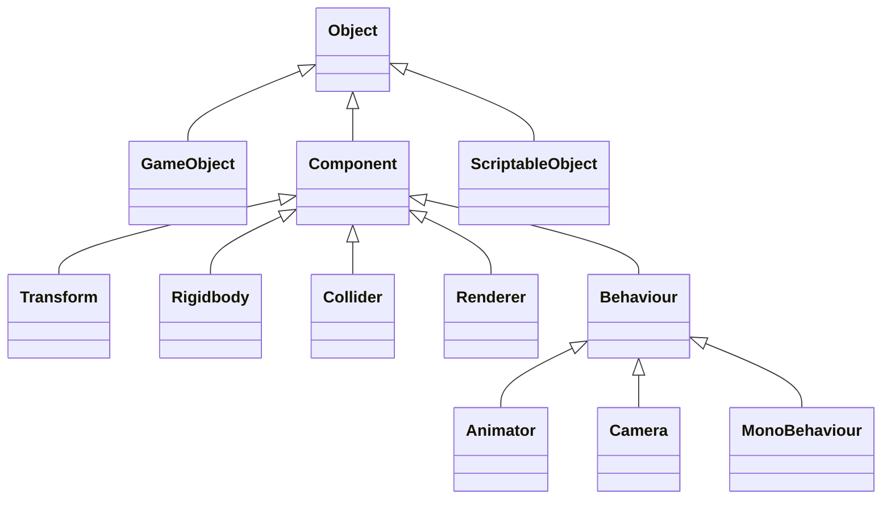
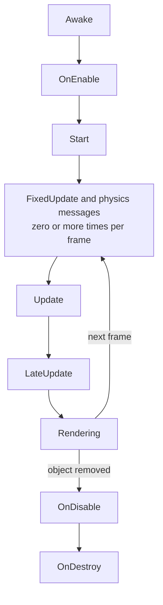

# Fundamentals

The ideas behind our rules. Read this once if you are new to object-oriented programming or Unity. `docs/CODING_STANDARDS.md` says how we write code, and this file explains why.

## Part 1: Object-oriented programming

### Classes and objects

A **class** is a blueprint, and an **object** is one thing built from it. A `Door` class describes every door. Each door in the game is an object with its own state, such as open or closed.

### The four main ideas

| Idea | Meaning | In a game |
|---|---|---|
| **Encapsulation** | An object protects its data and offers safe ways to change it | Nothing can set the coin count below zero by accident |
| **Abstraction** | Callers use what something does, not how it does it | An explosion calls `TakeDamage` without knowing what it hit |
| **Inheritance** | A class reuses and extends another class | Every Unity component script extends `MonoBehaviour` |
| **Polymorphism** | One call behaves differently depending on the object | `TakeDamage` breaks a crate but hurts an enemy |

**Encapsulation:** the data is private to change, and the only way in checks the rules.

```csharp
public sealed class Wallet
{
    public int Coins { get; private set; }

    public void Earn(int amount)
    {
        if (amount < 0)
        {
            throw new ArgumentOutOfRangeException(nameof(amount), amount, "Amount cannot be negative.");
        }

        Coins += amount;
    }
}
```

**Abstraction and polymorphism:** `Explosion` works with anything that can take damage, including types added next year.

```csharp
public interface IDamageable
{
    void TakeDamage(int amount);
}

public sealed class Crate : IDamageable
{
    public bool IsBroken { get; private set; }

    public void TakeDamage(int amount) => IsBroken = true;
}

public sealed class Enemy : IDamageable
{
    public int Health { get; private set; } = 30;

    public void TakeDamage(int amount) => Health -= amount;
}

public static class Explosion
{
    public static void Hit(IReadOnlyList<IDamageable> targets, int damage)
    {
        foreach (IDamageable target in targets)
        {
            target.TakeDamage(damage);
        }
    }
}
```

**Inheritance:** the base class fixes the steps, and each subclass fills in its part.

```csharp
public abstract class Ability
{
    public void Use()
    {
        if (CanUse())
        {
            Apply();
        }
    }

    protected virtual bool CanUse() => true;

    protected abstract void Apply();
}

public sealed class Dash : Ability
{
    public int TimesUsed { get; private set; }

    protected override void Apply() => TimesUsed++;
}
```

| Keyword | Meaning |
|---|---|
| `abstract` | Has no finished version, so a subclass must supply it |
| `virtual` | Has a default that a subclass may replace |
| `override` | Replaces the base version |
| `sealed` | Nothing can inherit from this class |

### Composition over inheritance

Inheritance is rigid. A flying enemy that also shoots does not fit neatly under either `FlyingEnemy` or `ShootingEnemy`. Composition builds an object from small parts instead, and it is how Unity itself works.

```text
Inheritance:  Enemy > FlyingEnemy > FlyingShootingEnemy > ...
Composition:  Enemy object = Health + Flyer + Shooter
```

Prefer composition. Use inheritance for a real "is a" relationship with shared steps.

### Interface or abstract class

| | Interface | Abstract class |
|---|---|---|
| Says | What something can do | What something is |
| Shared code | Normally none | Yes |
| A class can have | Many | One |
| Good for | Abilities such as `IDamageable` and fakes in tests | Families that share steps, such as `Ability` |

### Access modifiers

| Modifier | Who can use it |
|---|---|
| `private` | Only this class. Use this by default. |
| `protected` | This class and its subclasses |
| `internal` | Code in the same assembly |
| `public` | Everyone |

### Value types and reference types

A `struct` is a **value type**, so assigning it makes a copy. A `class` is a **reference type**, so assigning it shares the same object. `Vector3` is a struct, which explains a classic Unity error: `transform.position` gives you a copy, so you change the copy and assign it back.

```csharp
public sealed class Mover : MonoBehaviour
{
    private void MoveToFive()
    {
        // transform.position.x = 5f; does not compile, because it would change a temporary copy.
        Vector3 position = transform.position;
        position.x = 5f;
        transform.position = position;
    }
}
```

### Static members

`static` means the member belongs to the class, not to any one object. That suits pure helpers such as `Mathf.Max`. Static data that changes acts as a hidden global, so we avoid it.

### Events

An event lets an object announce something without knowing who is listening. Producers stay independent of their listeners.

```csharp
public sealed class Door
{
    public event Action Opened;

    public void Open() => Opened?.Invoke();
}
```

### SOLID

| Principle | Meaning | Example |
|---|---|---|
| **Single responsibility** | One reason to change | Input, movement and audio are separate scripts |
| **Open/closed** | Add new behaviour without editing old code | A new targeting rule is a new `TargetPicker` asset, and the code that uses it does not change |
| **Liskov substitution** | A subclass must keep the base class's promises | Every `TargetPicker` returns a valid index or -1 |
| **Interface segregation** | No class should depend on methods it does not use | `IDamageable` has no movement methods, so an explosion never depends on them |
| **Dependency inversion** | Rules and details both depend on an abstraction that the rules own | Logic owns `IRandomSource`, and View implements it with `UnityEngine.Random` |

Dependency inversion is the principle. Dependency injection is the technique that hands a class its real or fake dependency, and `docs/CODING_STANDARDS.md` shows how we do it.

## Part 2: How a game runs

A game is a loop. Every **frame**, it reads input, updates the world, then draws the result. All your code has to fit inside that loop.

| Idea | Meaning |
|---|---|
| **Frame budget** | At 60 frames per second, each frame has about 16.6 ms for everything. Slow code shows up as stutter. |
| **Delta time** | Frames vary in length, so scale movement by the time since the last frame. Otherwise, speed depends on the player's computer. |
| **Fixed timestep** | Physics runs at a steady rate, separate from the frame rate, so it stays stable. |
| **State** | What is true right now, such as health or the current level. Keep it in one clear place. |
| **State machine** | An object is in one mode at a time, with clear moves between modes. |
| **Data-driven design** | Values and content live in data, so the game can be tuned without changing code. |
| **Event-driven design** | Systems react when something happens, instead of checking every frame. |
| **Object pooling** | Reuse objects, because creating and destroying them often causes stutter. |
| **Game feel** | Fast, clear feedback through sound, animation and timing makes actions feel good. |

## Part 3: Unity fundamentals

### Building blocks

| Thing | What it is |
|---|---|
| **Scene** | A saved level or screen that holds GameObjects |
| **GameObject** | An empty container in a scene. It does nothing alone. |
| **Component** | A part attached to a GameObject that gives it behaviour |
| **Transform** | The component every GameObject has, for position, rotation, scale and parent |
| **Prefab** | A saved GameObject template you can reuse. Changing it updates every copy. |
| **Prefab Variant** | A prefab based on another, which inherits its changes |
| **Asset** | Any file in the project: a texture, sound, material, script or ScriptableObject |
| **ScriptableObject** | A data object saved as an asset, which lives outside any scene |

### Unity's main classes



| Class | Use |
|---|---|
| `MonoBehaviour` | Base class for scripts that sit on GameObjects |
| `ScriptableObject` | Base class for data assets |
| `GameObject` | Activate objects, and add or find their components |
| `Transform` | Move, rotate, scale and parent objects |
| `Rigidbody`, `Collider` | Physics bodies and shapes |
| `Animator`, `AudioSource`, `Camera` | Animation, sound and viewpoint |
| `Time` | Delta time and game speed |
| `Input` | Keyboard, mouse and controller input |
| `Physics` | Raycasts and overlap checks |
| `Debug` | Logs, assertions and debug lines |
| `Mathf`, `Vector3`, `Quaternion` | Math, positions and directions, and rotations |
| `SceneManager` | Load scenes |
| `JsonUtility` | Turn data into JSON and back |

The project currently uses Unity's older input system, `Input.GetKeyDown(KeyCode.Space)`. Unity recommends the newer Input System for new projects. It is a package, so adding it needs a team decision.

### MonoBehaviour

A `MonoBehaviour` is a script attached to a GameObject. Three things make it different from a normal C# class:

- **Unity creates it, not you.** Never write `new`. Use `AddComponent<T>()`, `Instantiate` or the Inspector.
- **It has no useful constructor.** Set it up in `Awake`, the Inspector or an `Initialize` method.
- **Unity calls its special methods by name.** They are not overrides, so a typo such as `Updte` gives no error and simply never runs.

### Special methods

Unity calls these methods, known as event functions, at set moments.



| Method | When it runs | Use it for |
|---|---|---|
| `Awake` | Once, when the object first becomes active, even if the script is disabled | Setting up this object, such as caching its components |
| `OnEnable` | Each time the script becomes enabled and active | Subscribing to events |
| `Start` | Once, before the first `Update`, only if the script is enabled | Using other objects and injected services |
| `FixedUpdate` | At a steady rate, 50 times per second in this project | Physics forces |
| `Update` | Once per frame | Input, timers and most game code |
| `LateUpdate` | Once per frame, after every `Update` | Follow cameras |
| `OnTriggerEnter`, `Stay`, `Exit` | When a collider overlaps a trigger | Pickups and zones |
| `OnCollisionEnter`, `Stay`, `Exit` | When solid colliders touch | Impacts |
| `OnDisable` | Each time the script is disabled, and before destruction | Unsubscribing from events |
| `OnDestroy` | Once, when the object is destroyed | Releasing what this object created |
| `OnApplicationPause`, `OnApplicationFocus` | When the game pauses or loses focus | Pausing, and saving on mobile |
| `OnApplicationQuit` | When a desktop build or Play Mode closes. It does not run on the Web and is unreliable on mobile. | Last-minute cleanup. Do not rely on it to save. |
| `Reset` | Editor only, when the script is added or reset | Filling in defaults |
| `OnValidate` | Editor only, when the script loads or a value changes | Checking Inspector values |
| `OnDrawGizmosSelected` | Editor only, when the object is selected | Drawing debug shapes |

Three details cause most lifecycle bugs:

- An inactive GameObject runs none of the runtime methods, from `Awake` to `OnDestroy`, until it is activated.
- `Awake` and `OnEnable` run inside `Instantiate` and `AddComponent`. `Start` runs later.
- The order between different objects is not guaranteed, so `Awake` must not depend on another object's `Awake`.

Delete empty `Update` methods, because each one still has a small cost.

### Time

| Property | Meaning |
|---|---|
| `Time.deltaTime` | Seconds since the last frame |
| `Time.fixedDeltaTime` | Seconds between physics steps |
| `Time.timeScale` | Game speed. At 0, `FixedUpdate` stops, but `Update` keeps running. |
| `Time.unscaledDeltaTime` | Delta time that ignores `timeScale`, useful for pause menus |

```csharp
public sealed class Spinner : MonoBehaviour
{
    [SerializeField, Tooltip("Degrees per second.")]
    private float _degreesPerSecond = 90f;

    private void Update() => transform.Rotate(0f, _degreesPerSecond * Time.deltaTime, 0f);
}
```

### What Unity saves

Unity saves field values into scenes, prefabs and assets. This is **serialization**. If a field is not serialized, the Inspector does not show it and its value is not saved.

| Saved | Not saved |
|---|---|
| `[SerializeField]` and `public` fields | `private` fields without `[SerializeField]` |
| Numbers, `string`, `bool`, enums | `static`, `const` and `readonly` fields |
| `Vector3`, `Color` and similar Unity types | Properties, unless marked `[field: SerializeField]` |
| Arrays and `List<T>` | Lists of lists and arrays of arrays |
| `Dictionary<K,V>` fields marked `[SerializeField]`, from Unity 6.6 | A `public` dictionary without `[SerializeField]`, or one nested inside another collection |
| Classes and structs marked `[Serializable]` | Interface fields. `[SerializeReference]` allows them, but only for plain `[Serializable]` classes, not components or ScriptableObjects. |
| References to Unity objects and assets | |

We use `[SerializeField] private`, because a `public` field lets any script change it.

A `[Serializable]` class is saved by value inside its owner. Once Unity has serialized it, the field is never null, and it keeps only the fields of its declared type, not those of a subclass.

### Physics

- A **Collider** is a shape. A **Rigidbody** makes an object part of the physics simulation.
- A **trigger** is a collider that detects overlaps without blocking anything.
- A trigger message needs a collider on both objects, `Is Trigger` on at least one, and a Rigidbody on at least one.
- A **kinematic** Rigidbody moves only from your code, not from forces or gravity.
- Move physics objects through their Rigidbody, not their Transform.
- 2D and 3D physics are separate. Use `Collider2D`, `Rigidbody2D` and `OnTriggerEnter2D` in 2D.

### Coroutines

A coroutine is a method that can pause and continue later, on the same object. It suits short sequences. `Awaitable` is the modern option when you need a result.

```csharp
public sealed class Blinker : MonoBehaviour
{
    [SerializeField, Min(0.01f), Tooltip("Seconds between blinks.")]
    private float _interval = 0.5f;

    [SerializeField, Tooltip("Renderer to blink.")]
    private Renderer _target;

    private void OnEnable() => StartCoroutine(BlinkRoutine());

    private IEnumerator BlinkRoutine()
    {
        while (true)
        {
            _target.enabled = !_target.enabled;
            yield return new WaitForSeconds(_interval);
        }
    }
}
```

### Connecting objects

Use the first option that fits:

1. **The Inspector:** a `[SerializeField]` reference to a prefab, asset or scene object.
2. **The same object:** `GetComponent` in `Awake`, then keep the result.
3. **Injection:** a constructor or `Initialize`, set up by the composition root.
4. **Events:** an event channel, when the sender should not know the receiver.

Avoid `GameObject.Find`, which is slow and breaks when a name changes. Avoid the `Object.Find...ByType` methods too. They are slow, and `FindObjectOfType` and `FindFirstObjectByType` are deprecated in this Unity version.

### Creating and removing objects

- `Instantiate(prefab)` creates a copy of a prefab.
- `Destroy(target)` removes an object at the end of the frame.
- `SetActive(false)` hides an object and stops its scripts. This is how pools reuse objects.
- `SceneManager.LoadScene` loads a scene on the next frame. By default, it unloads the current scene and destroys its objects, except those marked `DontDestroyOnLoad`. The scene must be in the build's scene list.
